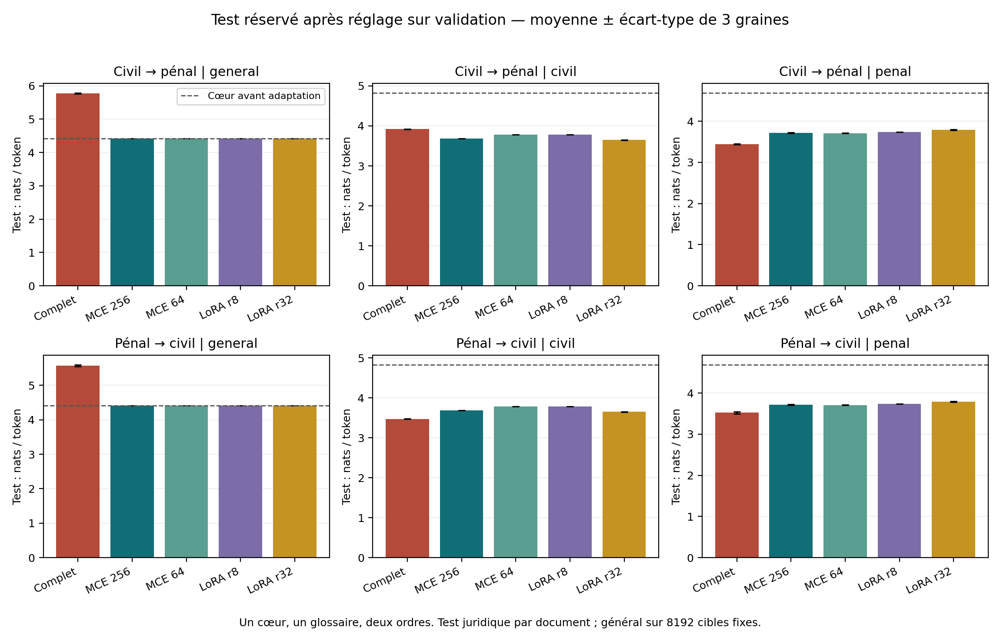

# Mandia MCE

Étude expérimentale de l’adaptation modulaire d’un petit modèle de langue français.

[English](README.md) | **Français**

Auteur : **mandia**. Expérience achevée le 10 octobre 2026. Manuscrit version 1.0. Non évalué par les pairs.

| Manuscrit | Source | PDF |
|---|---|---|
| Français | [Article complet](paper/article.fr.md) | [Télécharger](paper/article.fr.pdf) |
| English | [Full article](paper/article.en.md) | [Download](paper/article.en.pdf) |

## Question de recherche

Nous examinons si des modules indépendants peuvent adapter un petit modèle tout en conservant ses chemins de calcul précédemment gelés. L’étude compare les adapters résiduels Modular Continual Expansion (MCE), des banques LoRA séparées et l’entraînement complet sur des définitions civiles et pénales issues d’un glossaire juridique français.

Le Transformer partagé compte **17 129 280 paramètres** et a été préentraîné depuis une initialisation aléatoire sur **14 753 792 tokens vus**. Aucun poids préentraîné d’IvoireSLM n’a été utilisé. Cinq méthodes bénéficient de la même grille de trois taux d’apprentissage, puis de trois graines d’adaptation et des deux ordres de domaines : **15 réglages et 30 modèles finaux**. Chaque domaine reçoit 300 mises à jour, batch 4, contexte 256.

## Résultats principaux

Cross-entropy sur test réservé en nats par token, plus faible étant préférable. Moyennes sur trois graines, ordre civil puis pénal, route du domaine fournie pour chaque banque indépendante :

| Méthode | Paramètres entraînés par domaine | Général | Civil | Pénal |
|---|---:|---:|---:|---:|
| Entraînement complet | 17 129 280 | 5,772 | 3,920 | 3,442 |
| MCE 256 | 1 969 920 | 4,414 | 3,685 | 3,716 |
| MCE 64 | 495 360 | 4,414 | 3,780 | 3,710 |
| LoRA r8 | 516 096 | 4,414 | 3,782 | 3,736 |
| LoRA r32 | 2 064 384 | 4,414 | 3,649 | 3,788 |



MCE et les banques LoRA indépendantes conservent exactement leurs routes gelées dans cette expérience. À capacité voisine, LoRA r32 obtient une loss civile plus faible que MCE 256 ; MCE 256 obtient une loss pénale plus faible. L’entraînement complet adapte fortement le dernier domaine mais augmente la loss générale. Ces résultats n’établissent aucune supériorité universelle. Le manuscrit rapporte les deux ordres, écarts types, intervalles descriptifs appariés, coûts et contrôles de conservation.

Un routeur fermé de termes atteint **83,2 % d’accuracy** et **0,791 de macro-F1** sur 155 termes juridiques, contre **67,7 %** pour la classe majoritaire. Le rappel pénal est de **60 %**. Les losses de définition sous route prédite sont évaluées séparément. Le routeur n’est pas évalué sur des questions libres ou la détection du hors distribution.

## Réanalyse

La diffusion contient les observations numériques, sans textes du corpus, vocabulaire des termes, tokenizer ou poids. Les groupes de termes portent des identifiants hachés stables. Les calculs statistiques sont reproductibles sans GPU :

```bash
python -m venv .venv
source .venv/bin/activate
python -m pip install -r requirements-analysis.txt
python scripts/verify_release.py
python scripts/analyser_extension.py results/evidence analysis-output
python scripts/analyser_routeur.py
```

[Notebook Colab de réanalyse](https://colab.research.google.com/github/mandi-model/mandia-mce/blob/main/notebooks/reanalysis.ipynb)

Les tableaux et intervalles appariés ont été recalculés à une tolérance absolue de 1e-10. Les métriques et intervalles groupés du routeur ont également été reproduits. Le contrôle sur CPU effectue de vraies mises à jour sur des modèles miniatures MCE/LoRA aléatoires et vérifie les poids gelés, gradients, logits des anciennes routes et reconstructions :

```bash
python -m pip install -r requirements.txt
python scripts/smoke_model.py
```

Le réentraînement exact nécessite les entrées archivées et le cœur préentraîné, non distribués. Le runner GPU portable est vérifié en syntaxe et dérivé du runner historique exécuté ; il n’a pas été réexécuté pour cette diffusion. Voir [la reproduction](docs/reproduction.md) et [le rapport de validation](docs/validation.md).

## Portée et limites

L’étude est exploratoire : un seul cœur faiblement préentraîné, un split, un glossaire, deux domaines proches et trois graines d’adaptation. Le dropout diffère entre le complet et les méthodes à cœur gelé. Les nombres de paramètres sont voisins, les FLOPs ne sont pas égalisés. Le bootstrap groupé reste conditionnel au cœur et au split. La vraisemblance des définitions ne démontre ni raisonnement juridique ni exactitude factuelle. La conservation d’un chemin fixe ne garantit pas sa bonne sélection.

La conservation par gel possède des précédents dans les [réseaux progressifs](https://arxiv.org/abs/1606.04671), les [adapters NLP](https://proceedings.mlr.press/v97/houlsby19a.html) et [LoRA](https://arxiv.org/abs/2106.09685). Aucune nouveauté architecturale n’est revendiquée. Coopération, fusion, évaluation sur plusieurs corpus, baselines de replay et routage ouvert restent des expériences futures. [Architecture](docs/architecture.md).

## Contenu du dépôt

| Chemin | Contenu |
|---|---|
| Modules Python à la racine | Transformer causal, adapters, banques LoRA, chargement vérifié, inférence du routeur |
| `experiments/` | Extension GPU portable et évaluation du routage |
| `scripts/` | Réanalyse, figures anglaises, empreintes, contrôle CPU, génération des PDF |
| `results/evidence/` | Observations numériques, contrôles et provenance |
| `results/figures/` | Figures françaises et anglaises |
| `paper/` | Manuscrits complets français et anglais, Markdown et PDF |
| `docs/` | Architecture, protocoles, reproduction, validation, données et préparation arXiv |

## Provenance et citation

Les données juridiques proviennent de [bernard-ng/french-legal-glossary](https://huggingface.co/datasets/bernard-ng/french-legal-glossary), révision `f8c850c424af7a60ee55cf9eaf050cf05b59aba7`. La fiche déclare **CC BY-NC-SA 4.0** ; les droits des textes sous-jacents et leur exactitude juridique n’ont pas été vérifiés indépendamment. Les textes et poids sont exclus. L’accès public ne constitue pas une licence générale de redistribution ou d’usage commercial. [Données et droits](docs/data.md).

Citation proposée : **mandia (2026). Expansion modulaire d’un petit modèle français : adaptation juridique, ordre des domaines et routage des termes. Version 1.0.** Les deux manuscrits sont des versions linguistiques d’une seule étude. Aucun DOI ni identifiant arXiv n’est attribué. [Préparation arXiv](docs/arxiv.md).

OpenAI Codex a assisté l’implémentation, l’exécution, l’analyse et la rédaction. La responsabilité, l’interprétation et la relecture scientifiques restent humaines. Cette déclaration documente le travail effectué ; elle ne constitue pas une validation scientifique indépendante.
