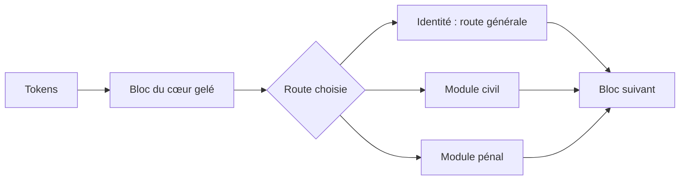

# Architecture et portée de la conservation

Le cœur causal compte 12 blocs, largeur 320, 8 têtes, SwiGLU 832, vocabulaire BPE 8192 et contexte 512. RMSNorm et RoPE sont employés ; embeddings et tête de sortie partagent leurs poids. Le total est 17 129 280 paramètres. L’adaptation et le test de cette étude utilisent le contexte 256.

## MCE résiduel

À la sortie de chaque bloc, le module du domaine choisi calcule :

```text
h' = h + W_up · Dropout(GELU(W_down · RMSNorm(h)))
```

`W_up` est initialisé à zéro. Une banque contient un module par bloc. MCE 256 ajoute 1 969 920 paramètres par domaine ; MCE 64 en ajoute 495 360. Lorsqu’un nouveau domaine arrive, le cœur et les banques précédentes sont gelés. Seule la nouvelle banque est entraînée.



Le schéma représente un bloc ; la même banque est choisie pour tous les blocs. L’entraînement du domaine B ne fait pas passer les représentations à travers la banque A. Les experts ne coopèrent pas et ne fusionnent pas.

## Pourquoi une ancienne route est conservée

Si tous les paramètres et buffers participant à une route restent identiques, que la même route est choisie et que l’inférence est déterministe, la fonction calculée reste identique. C’est une conséquence du gel des chemins. Les empreintes et les logits ont été contrôlés lors de cette expérience. Cela ne garantit pas qu’un routeur donnera encore la même route, ni que des compétences non évaluées sont acquises.

Cette conservation existe également avec les **banques LoRA indépendantes** de la comparaison. Elle ne prouve pas une nouvelle théorie générale de l’apprentissage continu. Le nombre de paramètres stockés augmente avec le nombre de domaines ; une seule banque est active par passage.

## Banque LoRA

Les matrices QKV et projection d’attention ainsi que gate/up/down du FFN portent des mises à jour de faible rang, séparées par domaine. Rangs 8 et 32, alpha/rang = 2, dropout 0,1. Les poids du cœur ne sont jamais fusionnés avec les adapters. L’activation de route est restaurée dans un `finally` après le forward. Les appels concurrents sur une même instance ne sont pas pris en charge.

## Travaux antérieurs

- [Progressive Neural Networks, Rusu et al., 2016](https://arxiv.org/abs/1606.04671) : colonnes gelées et expansion, avec connexions latérales. Les banques MCE utilisées ici ne lisent pas les anciens experts.
- [Parameter-Efficient Transfer Learning for NLP, Houlsby et al., 2019](https://proceedings.mlr.press/v97/houlsby19a.html) : adaptation par petits modules avec paramètres de base gelés.
- [LoRA, Hu et al., 2021](https://arxiv.org/abs/2106.09685) : mises à jour de faible rang ; les banques distinctes de ce dépôt permettent de conserver des routes antérieures.

L’apport de cette version est l’expérience comparée, ses contrôles, ses budgets et son analyse du routage sur un petit cœur français. Une nouveauté architecturale générale reste à établir.
