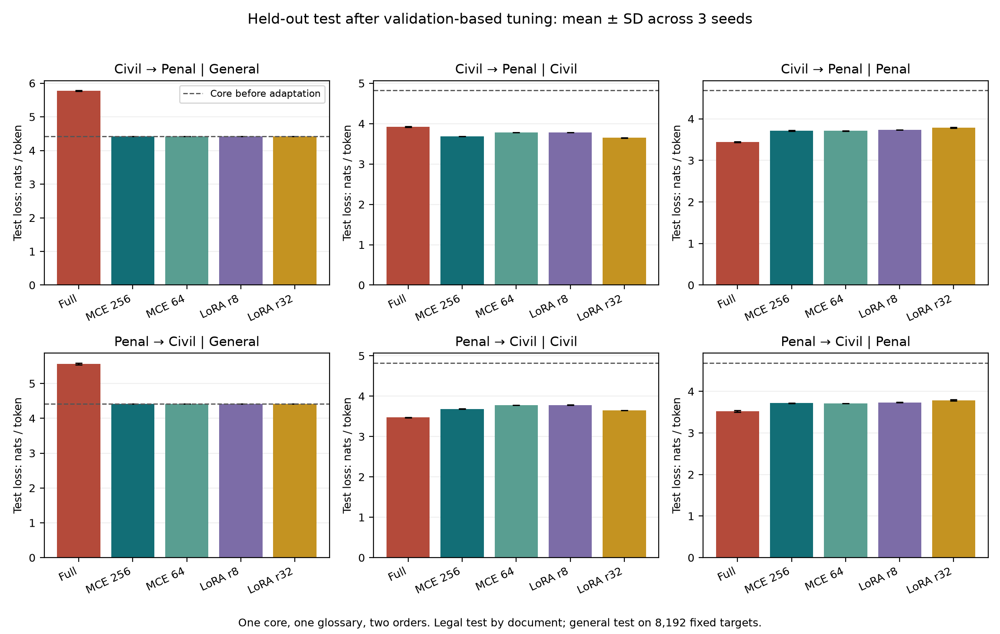
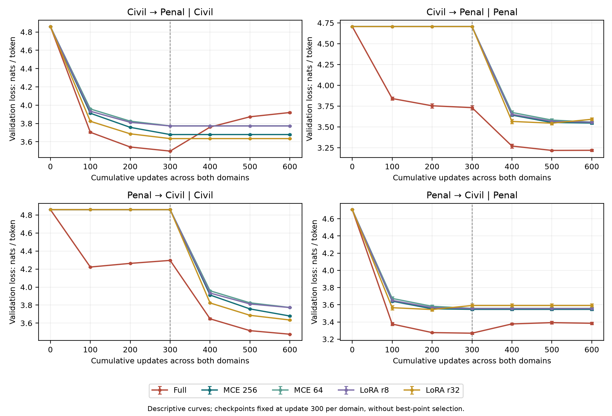

# Modular Expansion of a Small French Language Model: Legal Adaptation, Domain Order, and Term Routing

**mandia**

Version 1.0, 10 October 2026. Exploratory experimental study. This manuscript has not undergone peer review.

## Abstract

We study the addition of independent modules to a French language model with 17,129,280 parameters, pretrained from random initialization. An initial pilot with a single learning rate is extended through an equal three-rate search for each method, a capacity ablation, three new adaptation seeds, and both domain orders. The study compares full fine-tuning, two residual MCE adapter sizes, and two LoRA ranks. Hyperparameters are selected on validation data before final models are evaluated on the held-out test set. In the civil-then-penal order, MCE 256 reduces civil test loss from 4.823 to 3.685 and penal test loss from 4.683 to 3.716 nats per token; LoRA r32 reaches 3.649 and 3.788, respectively. Previously frozen routes are preserved by construction and verified experimentally, a property also shared by independent LoRA banks. A router trained on the supplied legal term alone achieves 83.2% test accuracy and a macro-F1 of 0.791; its effect on definition-completion loss is evaluated separately. The results characterize a trade-off between adaptation, route preservation, and expert selection within one glossary. They do not establish general superiority, legal reasoning, or architectural novelty.

**Keywords:** continual learning; parameter-efficient adaptation; language models; expert routing; definition modeling.

## 1. Introduction and Research Question

How can a small language model acquire a subdomain while preserving its previous computational routes? The initial Mandi hypothesis combines a stable shared core, expansion through specialized modules, a router, and possible cooperation among experts. This study evaluates independent modules and an initial closed-set term router. Expert cooperation, fusion, and questions spanning multiple domains are not implemented.

The experimental question is specific: given a fixed corpus, core, and adaptation budget, what trade-offs does a residual adapter bank offer relative to two independent LoRA banks and full fine-tuning? The extension addresses three limitations of the initial pilot: a single untuned learning rate, a single domain order, and the absence of held-out test evaluation.

Expansion with frozen previous computational paths has precedents in progressive neural networks [1]. NLP transfer adapters [2] and LoRA [3] provide established methods for adaptation with relatively few trainable parameters. Our MCE is an implementation of independent per-domain residual adapters placed after each Transformer block; we do not claim an entirely new architectural family. Unlike the lateral connections of progressive networks, the new experts in this implementation do not consume outputs from previous experts.

## 2. Model and Preservation Property

### 2.1 French Core and Domain Banks

The Mandi core has 12 layers, width 320, eight attention heads, a SwiGLU feed-forward dimension of 832, RMSNorm, RoPE, an 8,192-token BPE vocabulary, and tied input embeddings and output head. Its maximum context length is 512. It is randomly initialized and pretrained on a French subset of Wikipedia and FineWeb; no IvoireSLM weights are imported. At step 3,632, the checkpoint has seen 14,753,792 tokens. The prepared general-language training corpus contains 20,001,329 tokens. The tokenizer is learned from the training data and then fixed. The same core and weights are used for every adaptation model in the extension.

After each block, MCE adds a residual adapter comprising RMSNorm, a down projection, GELU, dropout, and an up projection. The up projection is initialized to zero. Bottleneck dimensions 256 and 64 add 1,969,920 and 495,360 parameters per domain, respectively. LoRA covers QKV and attention-output projections as well as the feed-forward gate, up, and down projections, with alpha/r = 2: 516,096 parameters at rank 8 and 2,064,384 at rank 32. The paired capacities are close rather than exactly equal. Full fine-tuning updates all 17,129,280 core parameters.

### 2.2 Conditional Proposition

Let f_d(x; θ, φ_d) denote a domain route, where θ is the shared core and φ_d is its domain module. If adding a new module changes neither θ nor φ_d, and changes neither the computation nor the selection of route d, then f_d after expansion equals f_d before expansion for the same input x and the same numerical inference conditions. Every operator and parameter on the selected path is preserved. This property also holds for an independent LoRA bank.

The proposition concerns the output of a fixed route, not the success of a router. It does not guarantee that a new module learns its domain, that a fusion preserves previous outputs, or that the system selects the correct expert. If the router changes its selection, system-level performance can deteriorate despite perfectly preserved modules. Weight, gradient, and logit checks test the preservation property; losses and the routing experiment assess the remaining aspects separately.

## 3. Data and Audit

The source file matches the `bernard-ng/french-legal-glossary` dataset at revision `f8c850c424af7a60ee55cf9eaf050cf05b59aba7` by SHA-256 [4]. Its dataset card declares a CC BY-NC-SA 4.0 license. That declaration does not independently verify the rights, jurisdiction, or date of the underlying texts. Dataset texts and model weights are not distributed in this release.

Only the exact categories “Droit civil” and “Droit pénal” are retained, following length, word-count, and multiline-term filters. Exact texts and definitions are globally deduplicated; term families sharing the same first word are grouped before splitting. Near duplicates are checked using Jaccard similarity of word five-grams at a threshold of 0.85, with no additional pair found. Group hashes determine the 80/10/10 split; no term group or exact duplicate crosses splits.

| Subdomain | Train: docs / tokens | Validation: docs / tokens | Test: docs / tokens |
|---|---:|---:|---:|
| Civil | 788 / 143 273 | 88 / 15 748 | 105 / 18 628 |
| Penal | 207 / 37 216 | 28 / 5 337 | 50 / 7 574 |

The additional audit compares each definition's word five-grams with the 27,587 general-language training documents. A flag requires at least 20 shared unique five-grams and coverage of at least 50% within a single general training document. One penal **training** definition is flagged; no test document reaches the specified threshold. This lexical check does not measure semantic overlap. Training data are not modified after the audit; a separate sensitivity analysis excludes flagged test documents if any exist. The two subdomains remain related through their source, style, and concepts.

## 4. Extension Protocol

### 4.1 Tuning Followed by Evaluation

The protocol and code are saved before final results are available. This is a locally prespecified extension, not a preregistration with an independent registry. Each of the five methods is tested with three maximum learning rates (0.0001, 0.0003, and 0.001) using seed 20261012 and the civil-then-penal order. Each trial performs 300 updates per domain. The selection criterion is the unweighted mean of final civil and penal validation losses; general-language loss is measured but excluded from selection. This criterion can favor a fully tuned model that sacrifices general-language performance. Ties favor the smaller learning rate.

| Method | Selected LR | Trainable parameters / domain |
|---|---:|---:|
| Full | 0.0001 | 17,129,280 |
| MCE 256 | 0.0010 | 1,969,920 |
| MCE 64 | 0.0010 | 495,360 |
| LoRA r8 | 0.0010 | 516,096 |
| LoRA r32 | 0.0010 | 2,064,384 |

The five selected learning rates are then frozen and fingerprinted before test evaluation. Seeds 20261013, 20261014, and 20261015 train the final models in both domain orders. Learning-rate selection benefits the first order; the reversed order tests sensitivity to reversal without additional optimization. The three seeds vary adaptation while retaining one core and one split. Every method is reported; no model is selected using test results.

### 4.2 Budget and Training

Each final model receives 300 updates per domain with batch size 4 and sequence length 256: 307,200 tokens per domain and 614,400 in total. Across 15 tuning runs and 30 final models, the extension processes 27,648,000 adaptation tokens, counting all methods and searches. Sampled windows are saved in advance and held identical by domain and seed across methods; domain-specific initialization seeds are preserved when the order is reversed. Penal adaptation samples approximately 8.25 times its available training-token volume, so repeated exposure may contribute to overfitting.

AdamW uses betas 0.9/0.95, weight decay 0.1 for matrices and zero for vector parameters, gradient clipping at 1, a 30-update warmup, and cosine decay to 10% of the maximum learning rate. The optimizer and schedule restart for each domain. Checkpoints are fixed at the final update 300; observations at updates 100 and 200 do not select a checkpoint. Parameter-efficient cores remain in evaluation mode during adaptation, with module dropout 0.1; the full model uses core dropout in training mode. This difference limits the comparison. Computation uses bfloat16 autocast with float32 weights on a Tesla T4 running PyTorch 2.11.0+cu130; native hardware BF16 support is not claimed.

### 4.3 Measurements and Uncertainty

We measure cross-entropy in nats per token, where lower values are preferable. Legal validation retains the pilot's concatenated streams; legal test evaluation operates by document in 256-token context blocks, without transitions between documents. A document's first token is not predicted; its EOS token is predicted. Civil and penal tests contain 18,523 and 7,524 target tokens, respectively. General-language evaluation uses 8,192 fixed validation targets and a distinct set of 8,192 test targets. These are partial estimates and are not interchangeable with the earlier full general-language validation at context length 512.

Tables report the mean and sample standard deviation across three seeds. First-domain forgetting is max(0, final validation loss minus the loss at the end of that domain's first training stage). For comparisons at nearby capacities, document negative log-likelihoods are averaged across seeds, followed by a paired bootstrap over term groups with 2,000 resamples and descriptive 95% intervals. This preserves document pairing but does not account for pretraining, split, or learning-rate-search variability. The intervals are exploratory; no confirmatory significance test is claimed.

## 5. Held-Out Test Results

### Civil Then Penal

| Method | Selected LR | General test | Civil test | Penal test | First-domain forgetting (validation) |
|---|---:|---:|---:|---:|---:|
| Full | 0.0001 | 5.772 ± 0.013 | 3.920 ± 0.008 | 3.442 ± 0.008 | 0.422 ± 0.009 |
| MCE 256 | 0.0010 | 4.414 ± 0.000 | 3.685 ± 0.003 | 3.716 ± 0.009 | 0.000 ± 0.000 |
| MCE 64 | 0.0010 | 4.414 ± 0.000 | 3.780 ± 0.002 | 3.710 ± 0.003 | 0.000 ± 0.000 |
| LoRA r8 | 0.0010 | 4.414 ± 0.000 | 3.782 ± 0.001 | 3.736 ± 0.003 | 0.000 ± 0.000 |
| LoRA r32 | 0.0010 | 4.414 ± 0.000 | 3.649 ± 0.004 | 3.788 ± 0.011 | 0.000 ± 0.000 |

### Penal Then Civil

| Method | Selected LR | General test | Civil test | Penal test | First-domain forgetting (validation) |
|---|---:|---:|---:|---:|---:|
| Full | 0.0001 | 5.565 ± 0.026 | 3.474 ± 0.005 | 3.522 ± 0.024 | 0.115 ± 0.026 |
| MCE 256 | 0.0010 | 4.414 ± 0.000 | 3.685 ± 0.003 | 3.716 ± 0.009 | 0.000 ± 0.000 |
| MCE 64 | 0.0010 | 4.414 ± 0.000 | 3.780 ± 0.002 | 3.710 ± 0.003 | 0.000 ± 0.000 |
| LoRA r8 | 0.0010 | 4.414 ± 0.000 | 3.782 ± 0.001 | 3.736 ± 0.003 | 0.000 ± 0.000 |
| LoRA r32 | 0.0010 | 4.414 ± 0.000 | 3.649 ± 0.004 | 3.788 ± 0.011 | 0.000 ± 0.000 |

The unadapted core obtains 4.414 on general-language test data, 4.823 on civil data, and 4.683 on penal data. Adaptation results are compared against these references within the same evaluation procedure. Improvements do not demonstrate the acquisition of entirely new facts: the source corpora may already share concepts.

Full fine-tuning illustrates the trade-off with preservation. After civil then penal, general test loss reaches 5.772 and civil validation forgetting reaches 0.422 nats per token; after penal then civil, general test loss reaches 5.565 and penal forgetting reaches 0.115. Independent banks retain the core's general-language loss and have zero measured forgetting on the preserved route. Their preservation does not guarantee the best adaptation to the most recently trained domain.

### 5.1 Paired Comparisons and Capacity

| Order | Domain | Difference | Mean (nats) | Descriptive 95% interval | Groups |
|---|---|---|---:|---:|---:|
| civil → penal | civil | MCE 256 minus LoRA r32 | 0.036 | [0.028 ; 0.045] | 58 |
| civil → penal | civil | MCE 64 minus LoRA r8 | -0.001 | [-0.007 ; 0.005] | 58 |
| civil → penal | penal | MCE 256 minus LoRA r32 | -0.073 | [-0.086 ; -0.050] | 31 |
| civil → penal | penal | MCE 64 minus LoRA r8 | -0.026 | [-0.038 ; -0.014] | 31 |
| penal → civil | civil | MCE 256 minus LoRA r32 | 0.036 | [0.028 ; 0.045] | 58 |
| penal → civil | civil | MCE 64 minus LoRA r8 | -0.001 | [-0.007 ; 0.005] | 58 |
| penal → civil | penal | MCE 256 minus LoRA r32 | -0.073 | [-0.086 ; -0.050] | 31 |
| penal → civil | penal | MCE 64 minus LoRA r8 | -0.026 | [-0.038 ; -0.014] | 31 |

A negative difference favors MCE. Comparisons pair MCE 256 with LoRA r32 and MCE 64 with LoRA r8. They address capacity trade-offs within this specific grid and do not establish superiority over all LoRA implementations, ranks, or hyperparameters.

For MCE 256 versus LoRA r32, the civil mean difference favors LoRA (+0.036 nats per token) and its descriptive interval is entirely positive. The penal mean difference favors MCE (-0.073) and its descriptive interval is entirely negative. For MCE 64 versus LoRA r8, the civil mean difference favors MCE (-0.001) but its descriptive interval includes zero; the penal difference favors MCE (-0.026) and its interval is entirely negative.

Reducing MCE's bottleneck from 256 to 64 costs 0.096 nats per token on civil test data. Penal means are 3.716 for MCE 256 and 3.710 for MCE 64, so higher capacity does not produce a uniform improvement in this experiment. This comparison is descriptive and does not identify an optimal size for other datasets.

### 5.2 Budget and Learning Order

The curves show progression during each adaptation and stability of the previous route. We report the fixed final checkpoint even when an intermediate observation has better validation loss. Independent banks do not use previously trained modules to learn the next domain; order reversal is therefore a structural control rather than evidence of transfer between experts. The maximum paired absolute difference between domain orders in modular-bank test losses is 0.00000000 nats per token. Full fine-tuning can respond differently to order because it updates the same parameters.

## 6. An Initial Learned Router: Definition Completion from a Supplied Term

We train a closed-set civil/penal router using only the term before the first newline. Definitions, expert losses, and test labels are not input features. Vocabulary and IDF are learned on training data: character TF-IDF with `char_wb`, two- to five-character n-grams, at most 20,000 features, and L2 normalization. Balanced logistic regression with max_iter = 1000 compares C = 0.1, 1, and 10. Validation macro-F1 selects C, breaking ties in favor of the smaller value; the selected C is 10.0.

Across 155 test terms and 84 groups, accuracy is 83.2% (descriptive interval 74.2%-89.4%) and macro-F1 is 0.791 (0.624-0.870). Majority-class accuracy is 67.7%. The bootstrap resamples term groups. The confusion matrix has true classes in rows and selected routes in columns, ordered civil then penal:

| True class | Civil route | Penal route |
|---|---:|---:|
| Civil | 99 | 6 |
| Penal | 20 | 30 |

For all 24 final banks, we reevaluate only definition and EOS tokens, excluding the supplied term tokens. Oracle and predicted routes are compared on identical targets using the actual preceding tokens at each position, that is, teacher forcing. We measure conditional likelihood rather than the quality of freely generated definitions. These values are not interchangeable with the preceding test table, which includes term tokens. The civil-then-penal order is shown below; detailed observations also include the reversed order.

| Bank | Civil definition: oracle | Civil definition: predicted route | Penal definition: oracle | Penal definition: predicted route |
|---|---:|---:|---:|---:|
| MCE 256 | 3.648 ± 0.004 | 3.680 ± 0.005 | 3.696 ± 0.010 | 3.759 ± 0.004 |
| MCE 64 | 3.742 ± 0.001 | 3.762 ± 0.001 | 3.684 ± 0.005 | 3.778 ± 0.004 |
| LoRA r8 | 3.740 ± 0.002 | 3.759 ± 0.004 | 3.708 ± 0.003 | 3.788 ± 0.005 |
| LoRA r32 | 3.608 ± 0.001 | 3.650 ± 0.001 | 3.763 ± 0.009 | 3.782 ± 0.003 |

This evaluation distinguishes preservation of an expert from selection of the correct expert. It provides an initial autonomous selection within two known categories; it does not detect general or out-of-distribution inputs, classify questions, or perform expert fusion. The general route is still selected explicitly. The router is saved as JSON and its decisions are reproduced after reconstruction, with maximum decision-function error 0.00e+00.

## 7. Computation, Memory, and Reproducibility

| Order | Method | Trainable parameters / domain | Training across two domains (s) | Peak allocated GPU (GB) |
|---|---|---:|---:|---:|
| civil → penal | Full | 17,129,280 | 44.04 ± 0.15 | 0.816 |
| civil → penal | MCE 256 | 1,969,920 | 34.35 ± 0.27 | 0.535 |
| civil → penal | MCE 64 | 495,360 | 32.99 ± 0.49 | 0.496 |
| civil → penal | LoRA r8 | 516,096 | 49.99 ± 0.99 | 0.571 |
| civil → penal | LoRA r32 | 2,064,384 | 49.75 ± 0.30 | 0.602 |
| penal → civil | Full | 17,129,280 | 43.97 ± 0.10 | 0.816 |
| penal → civil | MCE 256 | 1,969,920 | 34.31 ± 0.15 | 0.535 |
| penal → civil | MCE 64 | 495,360 | 32.90 ± 0.21 | 0.496 |
| penal → civil | LoRA r8 | 516,096 | 49.83 ± 0.26 | 0.571 |
| penal → civil | LoRA r32 | 2,064,384 | 50.28 ± 0.46 | 0.602 |

Training times cover synchronized update steps, excluding evaluations, fingerprinting, and input/output operations. Method order is rotated by seed; hardware and cache state remain sources of variability. PyTorch's peak allocated-memory counter is reset at the beginning of each domain rather than after intermediate validation, so the peak may include those evaluations. It is neither total reserved memory nor an `nvidia-smi` measurement. These measurements are not directly interchangeable with those of the initial pilot. The main extension takes 2,594.9 seconds; routing and manuscript preparation are additional.

All 30 final checkpoints are saved, read back with `weights_only=True`, reconstructed, and evaluated: maximum validation error is 0.00e+00. For independent banks, gradients of the core and previous experts remain absent; core and previous-expert fingerprints and probe logits are preserved exactly after a new domain is added. Results are serialized with sampling windows, configurations, curves, matrices, controls, document NLLs, routing decisions, and SHA-256 fingerprints. Full-model storage preserves embedding/head weight sharing; the initial pilot cloned these entries separately and overstated its disk cost.

The core fingerprint is `38233f63ee915a882ee49f0bbf79b280389101ab46f2d09d27ad2f08559e43ab`; the tokenizer fingerprint is `07fd856fa6e63c8e8594fda5b5d4317a11e906801c049066cd851eda328fb77d`. The recorded run is `legalextended_20261010T195007_533059Z`. The public repository at https://github.com/mandi-model/mandia-mce contains code, protocols, and numerical observations for recomputing tables and intervals. Term-group identifiers are replaced by stable hashes. Corpus texts, tokenizer, and weights are not distributed: exact retraining requires those archived inputs. Reanalysis of published observations is not an independent replication.

Delivered inference APIs are checked independently of the runner's reconstruction path on ten checkpoints, covering five methods, two orders, and seed 20261013: maximum error is 0.00e+00, weights are frozen, and logits are finite. All 155 JSON-router test decisions are reproduced. These additional checks are recorded in `helper_checks.json`.

## 8. Discussion and Limitations

Preservation under a fixed route is a verified structural property. Its occurrence is not evidence of novelty and also benefits the LoRA banks. Held-out test evaluation, reduced capacity, the learning-rate grid, and order reversal provide a more precise comparison than the single-rate pilot. The learned router selects an expert without a supplied domain label, but only for a narrow closed-set legal-term task.

The scope remains limited: one weakly pretrained core, one split, one glossary, two related subdomains, three adaptation seeds, and one tuning seed. The three-rate grid equalizes the number of trials, not exhaustive optimization. Learning rates are selected in only one order. Parameter counts are close, while FLOPs are not equalized; full-model dropout differs from frozen-core dropout. Replay, EWC, and a single module retrained sequentially are absent as baselines. The penal test set is small. Conditional intervals do not represent the full scientific uncertainty. Semantic contamination and the legal accuracy of source definitions are not verified.

Losses evaluate definition modeling rather than reasoning, a question-answering benchmark, an applicable legal capability, or guaranteed acquisition of knowledge absent from the core. Completion under predicted routing depends on a supplied term and does not evaluate routing of open-ended questions. Experts do not cooperate; general and out-of-distribution routing remain untested.

The planned confirmatory legal/history/science/economics protocol, independent splits and cores, dropout controls, factual and question evaluations, and subsequent fusion experiments explicitly measuring preservation remain necessary to broaden the conclusion. This article reports the completed experiment and its limits without presenting future work as completed results.

## 9. Conclusion

Within this glossary, the experiment jointly measures textual adaptation, computational-route preservation, capacity and order sensitivity, and the cost of errors from an initial router. Independent-module expansion is documented; statistical calculations are reproducible from published numerical observations, while exact retraining requires inputs not included in the release. The broader Mandi proposal, particularly expert cooperation and generalization across corpora, remains a hypothesis to test.

## Software Assistance and Author Responsibility

OpenAI Codex assisted implementation, protocol execution in Colab, analysis, and manuscript preparation. Reported results come from the observed experiment files; this assistance does not replace scientific review or the author's responsibility. No AI system is designated as a coauthor. Complete human review remains necessary before formal submission.

## References

[1] Rusu, A. A. et al. (2016). *Progressive Neural Networks*. [arXiv:1606.04671](https://arxiv.org/abs/1606.04671).

[2] Houlsby, N. et al. (2019). *Parameter-Efficient Transfer Learning for NLP*. ICML, PMLR 97, 2790-2799. [Original article](https://proceedings.mlr.press/v97/houlsby19a.html).

[3] Hu, E. J. et al. (2021). *LoRA: Low-Rank Adaptation of Large Language Models*. [arXiv:2106.09685](https://arxiv.org/abs/2106.09685).

[4] Bernard Ngandu. *French Legal Glossary*. [Dataset card](https://huggingface.co/datasets/bernard-ng/french-legal-glossary), revision `f8c850c424af7a60ee55cf9eaf050cf05b59aba7`; provenance verified on 9 October 2026.

## Appendix: Files for Reanalysis

The historical extension protocol is `protocol.md`; the prespecified router appendix is `router_protocol_predefined.md`. `selected_hyperparameters.json` preserves the learning-rate choice made before test evaluation, and `tuning_results.json` contains all 15 trials. `validation_curves.json` contains 945 observations; `test_results.json` contains 90 results with document NLLs and general-language windows. `routed_test_results.json` contains 48 results under predicted routing. `reload_checks.json` contains all 30 reconstructions. Historical model, adapter, runner, and router sources are archived with their manifest. Checkpoints contain final inference states; optimizer-resumption state is not saved.

In the public repository, numerical files are under `results/evidence/` and protocols are under `docs/`. Model and adapter files are the executed sources; the runners under `experiments/` adapt local paths and cloud mounting from the historical runner. PDF generation uses `scripts/render_paper.py` with ReportLab and `MCE_FONTS_DIR` pointing to DejaVu font files. The French and English manuscripts report the same observations and constitute two language versions of one study.
