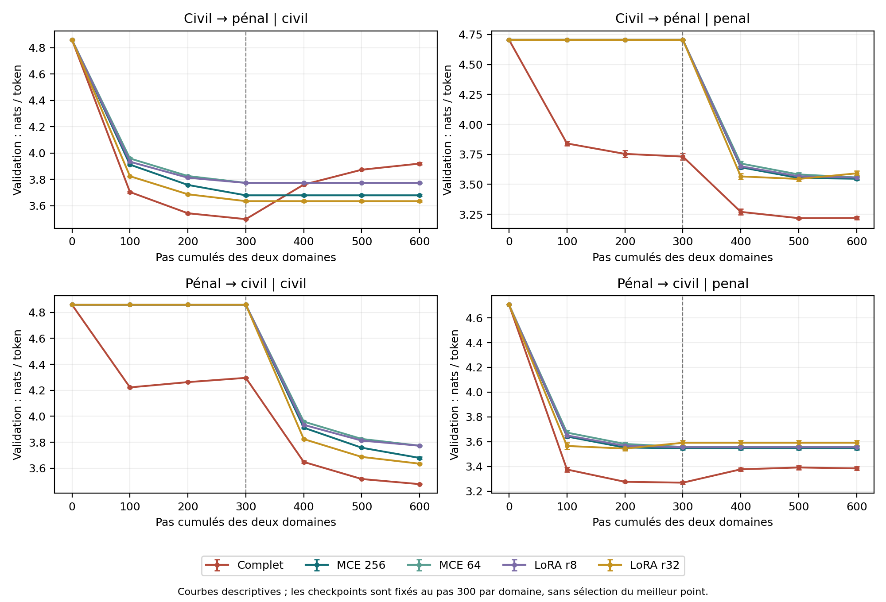

# Expansion modulaire d’un petit modèle français : adaptation juridique, ordre des domaines et routage des termes

**mandia**

Version 1.0, 10 octobre 2026. Étude expérimentale exploratoire. Manuscrit non évalué par les pairs.

## Résumé

Nous étudions l’ajout de modules indépendants à un modèle de langage français de 17 129 280 paramètres entraîné depuis zéro. Un premier pilote à taux d’apprentissage unique est prolongé par une recherche identique de trois taux par méthode, une ablation de capacité, trois nouvelles graines et deux ordres d’adaptation. L’extension compare l’entraînement complet, deux tailles d’adapters résiduels MCE et deux rangs LoRA. Les réglages sont sélectionnés sur validation, puis les modèles finaux sont évalués sur le test réservé. Dans l’ordre civil puis pénal, MCE 256 réduit la loss test civile de 4.823 à 3.685 et pénale de 4.683 à 3.716 nats/token ; LoRA r32 atteint respectivement 3.649 et 3.788. Les routes antérieures gelées sont conservées par construction et vérifiées, propriété également partagée par les banques LoRA. Un routeur appris à partir du terme seul obtient une accuracy test de 83.2 % et un macro F1 de 0.791 ; son impact sur la loss de complétion des définitions est mesuré séparément. Ces résultats caractérisent un compromis d’adaptation, de conservation et de sélection d’expert sur un glossaire. Ils n’établissent ni supériorité générale, ni raisonnement juridique, ni nouveauté architecturale.

**Mots-clés :** apprentissage continu ; adaptation efficace en paramètres ; modèles de langue ; routage d’experts ; modélisation de définitions.

## 1. Introduction et question de recherche

Comment ajouter un sous-domaine à un petit modèle sans modifier ses chemins antérieurs ? L’hypothèse initiale Mandi combine un cœur stable, une expansion par modules spécialisés, un routeur et une coopération éventuelle entre experts. Nous évaluons ici les modules indépendants et un premier routeur fermé de termes. La coopération, la fusion et les questions traversant plusieurs domaines ne sont pas implémentées.

La question expérimentale est précise : à corpus, cœur et budget d’adaptation fixés, quels compromis obtient une banque d’adapters résiduels face à deux banques LoRA et à l’entraînement complet ? L’extension examine trois limites du pilote initial : taux unique non optimisé, ordre unique et absence d’évaluation sur test.

La croissance avec chemins antérieurs gelés possède des précédents dans les réseaux progressifs [1]. Les adapters pour le transfert NLP [2] et LoRA [3] fournissent des méthodes établies d’adaptation avec un nombre réduit de paramètres. Notre MCE est une implémentation d’adapters résiduels indépendants par domaine, placés après chaque bloc ; nous ne revendiquons pas une famille d’architecture entièrement nouvelle. Contrairement aux connexions latérales des réseaux progressifs, nos nouveaux experts ne lisent pas les anciens experts.

## 2. Modèle et propriété de conservation

### 2.1 Cœur français et banques

Le cœur Mandi comprend 12 couches, largeur 320, 8 têtes d’attention, FFN SwiGLU 832, RMSNorm, RoPE, vocabulaire BPE 8192 et embeddings/tête liés. Le contexte maximal est 512. Il est initialisé aléatoirement et préentraîné sur un sous-ensemble français de Wikipédia et FineWeb ; aucun poids IvoireSLM n’est importé. Au pas 3632, il a vu 14 753 792 tokens. Le corpus général préparé contient 20 001 329 tokens train. Le tokenizer est appris sur train et fixé. Ce cœur et ces poids sont identiques pour tous les modèles d’adaptation de l’extension.

MCE ajoute après chaque bloc un adapter RMSNorm → projection descendante → GELU → dropout → projection ascendante résiduelle. La projection ascendante est initialisée à zéro. Les bottlenecks 256 et 64 ajoutent respectivement 1 969 920 et 495 360 paramètres par domaine. LoRA couvre les projections QKV et sortie d’attention ainsi que gate/up/down FFN, avec alpha/r = 2 : 516 096 paramètres au rang 8, 2 064 384 au rang 32. Les tailles comparées sont voisines, sans égalité exacte. Le complet entraîne les 17 129 280 paramètres.

### 2.2 Proposition conditionnelle

Soit f_d(x ; θ, φ_d) le chemin d’un domaine, où θ est le cœur et φ_d le module. Si l’ajout d’un nouveau module ne modifie ni θ, ni φ_d, ni le calcul ou la sélection du chemin d, alors f_d après expansion est identique à f_d avant expansion, pour le même x et les mêmes conditions numériques d’inférence. En effet, tous les opérateurs et paramètres du chemin sélectionné sont conservés. La propriété vaut également pour une banque LoRA indépendante.

Cette proposition concerne la sortie d’un chemin fixé, pas la réussite d’un routeur. Elle ne garantit pas que le nouveau module apprend un domaine, ni qu’une fusion conserve les anciennes sorties, ni qu’un système choisit le bon expert. Si le routeur change de choix, la performance globale peut se dégrader malgré des modules parfaitement conservés. Les contrôles de poids, gradients et logits testent cette propriété ; les losses et l’expérience de routage testent les autres aspects séparément.

## 3. Données et audit

Le fichier source correspond par SHA-256 au dataset `bernard-ng/french-legal-glossary`, révision `f8c850c424af7a60ee55cf9eaf050cf05b59aba7` [4]. Sa fiche déclare CC BY-NC-SA 4.0. Cette déclaration ne vérifie pas indépendamment les droits des textes sous-jacents, leur juridiction ou leur date. Les données textuelles et les poids de l’étude ne sont pas distribués dans cette version.

Nous retenons uniquement les catégories exactes « Droit civil » et « Droit pénal », après filtres de longueur, nombre de mots et termes multilignes. Les textes et définitions exactes sont dédupliqués globalement ; les familles partageant le premier mot du terme sont regroupées avant split. Les quasi-doublons sont recherchés par Jaccard de 5-grammes de mots à seuil 0,85, sans paire supplémentaire trouvée. Les groupes déterminent le split 80/10/10 par hash ; aucun groupe ni doublon exact ne traverse les splits.

| Sous-domaine | Train : docs / tokens | Validation : docs / tokens | Test : docs / tokens |
|---|---:|---:|---:|
| Civil | 788 / 143 273 | 88 / 15 748 | 105 / 18 628 |
| Pénal | 207 / 37 216 | 28 / 5 337 | 50 / 7 574 |

L’audit supplémentaire compare les 5-grammes de chaque définition aux 27 587 documents du train général. Un signal requiert au moins 20 5-grammes communs et une couverture d’au moins 50 % dans un même document général. Il signale une définition pénale du train ; aucun document test n’atteint le seuil fixé. Ce contrôle lexical ne mesure pas le chevauchement sémantique. Le train n’est pas modifié après cet audit ; une analyse de sensibilité distincte retire les documents test signalés, si présents. Les deux sous-domaines restent liés par leur source, leur style et leurs concepts.

## 4. Protocole de l’extension

### 4.1 Réglage puis évaluation

Le protocole et le code sont enregistrés avant les résultats finaux. Il s’agit d’une extension locale préspécifiée, pas d’une préinscription auprès d’un registre indépendant. Pour chacune des cinq méthodes, trois LR maximaux (0,0001 ; 0,0003 ; 0,001) sont essayés sur la graine 20261012 dans l’ordre civil puis pénal. Chaque essai utilise 300 pas par domaine. Le critère est la moyenne non pondérée des losses finales civile et pénale sur validation ; le général est mesuré mais exclu de la sélection. Ce critère peut favoriser un complet qui sacrifie le général. Le LR inférieur tranche les égalités.

| Méthode | LR retenu | Paramètres entraînés / domaine |
|---|---:|---:|
| Complet | 0.0001 | 17,129,280 |
| MCE 256 | 0.0010 | 1,969,920 |
| MCE 64 | 0.0010 | 495,360 |
| LoRA r8 | 0.0010 | 516,096 |
| LoRA r32 | 0.0010 | 2,064,384 |

Les cinq LR sont ensuite gelés et empreintés avant évaluation test. Les graines 20261013/14/15 entraînent les modèles finaux dans les deux ordres. Le choix de LR bénéficie au premier ordre ; le second mesure la robustesse à l’inversion sans nouvelle optimisation. Les trois graines font varier l’adaptation, avec un cœur et un split uniques. Toutes les méthodes sont rapportées ; aucun modèle n’est choisi selon le test.

### 4.2 Budget et entraînement

Chaque modèle final reçoit 300 mises à jour par domaine, batch 4, séquence 256 : 307 200 tokens par domaine, 614 400 au total. L’extension entraîne 15 modèles de réglage et 30 modèles finaux, soit 27 648 000 tokens d’adaptation en comptant toutes les méthodes et recherches. Les fenêtres sont préenregistrées et identiques par domaine et graine pour tous les modèles ; les graines d’initialisation par domaine sont conservées lors de l’inversion. Le pénal voit environ 8,25 fois le volume de son train en tokens échantillonnés : la répétition peut contribuer au surapprentissage.

AdamW utilise betas 0,9/0,95, weight decay 0,1 sur matrices et 0 sur paramètres vectoriels, clip 1, chauffe 30 pas puis cosinus jusqu’à 10 % du LR maximal. Optimiseur et calendrier redémarrent à chaque domaine. Le checkpoint est fixé au dernier pas 300 ; les points 100 et 200 ne servent pas à sélectionner un checkpoint. Les cœurs PEFT restent en eval pendant l’adaptation, leurs modules ont dropout 0,1 ; le complet utilise le dropout du cœur en mode train. Cette différence est une limite de comparaison. Le calcul utilise autocast bfloat16 et poids float32 sur Tesla T4 avec PyTorch 2.11.0+cu130, sans BF16 matériel natif revendiqué.

### 4.3 Mesures et incertitude

Nous mesurons la cross-entropy en nats/token, plus faible étant préférable. La validation juridique conserve les concaténations du pilote ; le test juridique est évalué par document, en blocs de contexte 256, sans transition entre documents. Le premier token d’un document n’est pas prédit et l’EOS l’est. Les tests civil et pénal comportent 18 523 et 7 524 cibles. Le général utilise 8192 cibles fixes de validation puis 8192 cibles distinctes de test. Ce sont des estimations partielles ; elles ne se mélangent pas à l’ancienne validation générale complète en contexte 512.

Les tableaux donnent moyenne ± écart-type sur trois graines. L’oubli du premier domaine est max(0, loss finale de validation − loss à la fin de son premier entraînement). Pour les comparaisons de capacité voisine, les NLL documentaires sont moyennées sur les graines, puis un bootstrap apparié par groupes de termes fournit 2000 tirages et un intervalle descriptif à 95 %. Il respecte l’appariement des documents, mais ne couvre ni la variabilité du préentraînement, ni celle des splits ou de la recherche de LR. Les intervalles sont exploratoires ; aucun test confirmatoire de significativité n’est annoncé.

## 5. Résultats sur test réservé

### Civil puis pénal

| Méthode | LR retenu | Test général | Test civil | Test pénal | Oubli du premier domaine (validation) |
|---|---:|---:|---:|---:|---:|
| Complet | 0.0001 | 5.772 ± 0.013 | 3.920 ± 0.008 | 3.442 ± 0.008 | 0.422 ± 0.009 |
| MCE 256 | 0.0010 | 4.414 ± 0.000 | 3.685 ± 0.003 | 3.716 ± 0.009 | 0.000 ± 0.000 |
| MCE 64 | 0.0010 | 4.414 ± 0.000 | 3.780 ± 0.002 | 3.710 ± 0.003 | 0.000 ± 0.000 |
| LoRA r8 | 0.0010 | 4.414 ± 0.000 | 3.782 ± 0.001 | 3.736 ± 0.003 | 0.000 ± 0.000 |
| LoRA r32 | 0.0010 | 4.414 ± 0.000 | 3.649 ± 0.004 | 3.788 ± 0.011 | 0.000 ± 0.000 |

### Pénal puis civil

| Méthode | LR retenu | Test général | Test civil | Test pénal | Oubli du premier domaine (validation) |
|---|---:|---:|---:|---:|---:|
| Complet | 0.0001 | 5.565 ± 0.026 | 3.474 ± 0.005 | 3.522 ± 0.024 | 0.115 ± 0.026 |
| MCE 256 | 0.0010 | 4.414 ± 0.000 | 3.685 ± 0.003 | 3.716 ± 0.009 | 0.000 ± 0.000 |
| MCE 64 | 0.0010 | 4.414 ± 0.000 | 3.780 ± 0.002 | 3.710 ± 0.003 | 0.000 ± 0.000 |
| LoRA r8 | 0.0010 | 4.414 ± 0.000 | 3.782 ± 0.001 | 3.736 ± 0.003 | 0.000 ± 0.000 |
| LoRA r32 | 0.0010 | 4.414 ± 0.000 | 3.649 ± 0.004 | 3.788 ± 0.011 | 0.000 ± 0.000 |

Le cœur seul obtient 4.414 sur le test général, 4.823 sur le civil et 4.683 sur le pénal. Les adaptations de chaque méthode sont comparées à ces références dans le même calcul. Les gains d’adaptation ne démontrent pas l’apprentissage de faits entièrement nouveaux : les sources peuvent déjà partager des concepts.

L’entraînement complet illustre le compromis avec la conservation : après civil puis pénal, le test général atteint 5.772 et l’oubli civil de validation 0.422 nats/token ; après pénal puis civil, le test général atteint 5.565 et l’oubli pénal 0.115. Les banques indépendantes gardent la valeur générale du cœur et un oubli de route nul. Leur conservation ne garantit pas la meilleure adaptation sur le dernier domaine.

### 5.1 Comparaisons appariées et capacité

| Ordre | Domaine | Différence | Moyenne (nats) | Intervalle descriptif 95 % | Groupes |
|---|---|---|---:|---:|---:|
| civil → penal | civil | MCE minus LoRA_r32 | 0.036 | [0.028 ; 0.045] | 58 |
| civil → penal | civil | MCE64 minus LoRA_r8 | -0.001 | [-0.007 ; 0.005] | 58 |
| civil → penal | penal | MCE minus LoRA_r32 | -0.073 | [-0.086 ; -0.050] | 31 |
| civil → penal | penal | MCE64 minus LoRA_r8 | -0.026 | [-0.038 ; -0.014] | 31 |
| penal → civil | civil | MCE minus LoRA_r32 | 0.036 | [0.028 ; 0.045] | 58 |
| penal → civil | civil | MCE64 minus LoRA_r8 | -0.001 | [-0.007 ; 0.005] | 58 |
| penal → civil | penal | MCE minus LoRA_r32 | -0.073 | [-0.086 ; -0.050] | 31 |
| penal → civil | penal | MCE64 minus LoRA_r8 | -0.026 | [-0.038 ; -0.014] | 31 |

Une différence négative favorise MCE. Les comparaisons opposent MCE 256 à LoRA r32, puis MCE 64 à LoRA r8. Elles répondent à la question du compromis de capacité dans cette grille précise. Elles ne prouvent pas une supériorité sur toutes les implémentations, rangs ou hyperparamètres LoRA.

MCE 256 face à LoRA r32 : sur le civil, l’écart moyen favorise LoRA r32 (+0.036 nats/token) et son intervalle descriptif reste entièrement positif ; sur le pénal, l’écart moyen favorise MCE 256 (-0.073 nats/token) et son intervalle descriptif reste entièrement négatif.

MCE 64 face à LoRA r8 : sur le civil, l’écart moyen favorise MCE 64 (-0.001 nats/token) et son intervalle descriptif inclut zéro ; sur le pénal, l’écart moyen favorise MCE 64 (-0.026 nats/token) et son intervalle descriptif reste entièrement négatif.

Réduire MCE de 256 à 64 coûte 0.096 nats/token sur le test civil. Sur le pénal, les moyennes sont 3.716 pour MCE 256 et 3.710 pour MCE 64 : la capacité supérieure n’apporte donc pas un gain uniforme dans cette expérience. Cette comparaison reste descriptive et ne fixe pas une taille optimale pour d’autres données.

### 5.2 Budget et ordre d’apprentissage

Les courbes rendent visibles l’évolution pendant chaque adaptation et la stabilité de la route antérieure. Nous rapportons le checkpoint final fixé, même lorsqu’un point intermédiaire a une meilleure validation. Les méthodes indépendantes n’utilisent pas les modules précédents pour apprendre le suivant ; l’inversion est donc un contrôle structurel plutôt qu’une démonstration de transfert entre experts. L’écart absolu maximal apparié entre ordres sur les losses test des banques modulaires est 0.00000000 nats/token. L’entraînement complet peut réagir différemment à l’ordre, puisqu’il met à jour les mêmes paramètres.

## 6. Premier routeur appris : complétion de définitions à partir du terme

Nous entraînons un routeur fermé civil/pénal à partir du terme avant le premier saut de ligne. La définition, les losses des experts et les étiquettes de test ne sont pas des features. Le vocabulaire et l’IDF sont appris sur train : TF-IDF de caractères `char_wb`, n-grammes 2 à 5, maximum 20 000 features, normalisation L2. Une régression logistique avec classes balanced et max_iter 1000 compare C = 0,1 / 1 / 10. Le macro F1 validation choisit C, avec préférence au plus faible en cas d’égalité ; C retenu = 10.0.

Sur 155 termes test et 84 groupes, l’accuracy est 83.2 % (intervalle descriptif [74.2 ; 89.4] %), le macro F1 0.791 ([0.624 ; 0.870]). La référence de classe majoritaire vaut 67.7 %. Le bootstrap rééchantillonne les groupes de termes. La matrice de confusion a pour lignes les vraies classes et pour colonnes les routes choisies, civil puis pénal :

| Vraie classe | Route civile | Route pénale |
|---|---:|---:|
| Civil | 99 | 6 |
| Pénal | 20 | 30 |

Pour les 24 banques finales, nous réévaluons uniquement les tokens de définition et EOS, en excluant les tokens du terme fourni. Routes oracle et prédites sont comparées sur les mêmes cibles, avec les préfixes réels fournis à chaque position (teacher forcing). Nous mesurons une vraisemblance conditionnelle, pas la qualité de définitions générées librement ; les valeurs suivantes ne se mélangent pas au tableau précédent qui inclut les termes. L’ordre civil puis pénal est présenté ici ; le fichier détaillé contient aussi l’ordre inverse.

| Banque | Définition civile : oracle | Définition civile : route prédite | Définition pénale : oracle | Définition pénale : route prédite |
|---|---:|---:|---:|---:|
| MCE 256 | 3.648 ± 0.004 | 3.680 ± 0.005 | 3.696 ± 0.010 | 3.759 ± 0.004 |
| MCE 64 | 3.742 ± 0.001 | 3.762 ± 0.001 | 3.684 ± 0.005 | 3.778 ± 0.004 |
| LoRA r8 | 3.740 ± 0.002 | 3.759 ± 0.004 | 3.708 ± 0.003 | 3.788 ± 0.005 |
| LoRA r32 | 3.608 ± 0.001 | 3.650 ± 0.001 | 3.763 ± 0.009 | 3.782 ± 0.003 |

Ce test rend explicite l’écart entre conservation de l’expert et bon choix de l’expert. Il constitue une première sélection autonome à l’intérieur de deux catégories connues ; il ne détecte pas le général ou les entrées hors distribution, ne classe pas les questions et n’assure pas de fusion. Le chemin général reste explicitement sélectionné. Le routeur est sauvegardé en JSON et ses décisions sont reproduites après reconstruction, erreur maximale sur la fonction de décision 0.00e+00.

## 7. Calcul, mémoire et reproductibilité

| Ordre | Méthode | Paramètres entraînés / domaine | Calcul des deux domaines (s) | Pic alloué GPU (GB) |
|---|---|---:|---:|---:|
| civil → penal | Complet | 17,129,280 | 44.04 ± 0.15 | 0.816 |
| civil → penal | MCE 256 | 1,969,920 | 34.35 ± 0.27 | 0.535 |
| civil → penal | MCE 64 | 495,360 | 32.99 ± 0.49 | 0.496 |
| civil → penal | LoRA r8 | 516,096 | 49.99 ± 0.99 | 0.571 |
| civil → penal | LoRA r32 | 2,064,384 | 49.75 ± 0.30 | 0.602 |
| penal → civil | Complet | 17,129,280 | 43.97 ± 0.10 | 0.816 |
| penal → civil | MCE 256 | 1,969,920 | 34.31 ± 0.15 | 0.535 |
| penal → civil | MCE 64 | 495,360 | 32.90 ± 0.21 | 0.496 |
| penal → civil | LoRA r8 | 516,096 | 49.83 ± 0.26 | 0.571 |
| penal → civil | LoRA r32 | 2,064,384 | 50.28 ± 0.46 | 0.602 |

Ces temps couvrent les étapes d’entraînement synchronisées, hors évaluations, empreintes et IO. Les méthodes tournent dans un ordre décalé selon la graine ; le matériel et le cache restent des facteurs de variabilité. Le compteur de pic alloué PyTorch est réinitialisé au début de chaque domaine, pas après les validations intermédiaires : le pic peut inclure ces évaluations. Il ne représente ni toute la mémoire réservée, ni une mesure `nvidia-smi`. La mesure n’est pas directement interchangeable avec celle du premier pilote. L’extension principale dure 2594.9 secondes ; le routeur et la préparation du manuscrit sont supplémentaires.

Les 30 checkpoints finaux sont sauvegardés, relus avec `weights_only=True`, reconstruits et évalués : erreur maximale de validation 0.00e+00. Pour les banques, les gradients du cœur et des anciens experts restent absents ; les empreintes du cœur et de l’ancien expert ainsi que les logits d’un probe sont conservés exactement après le nouvel ajout. Les résultats sont sérialisés avec fenêtres, configurations, courbes, matrices, contrôles, NLL par document, décisions du routeur et empreintes SHA-256. Le stockage du complet conserve le partage embeddings/tête ; le premier pilote clonait séparément ces entrées et surestimait son coût disque.

L’empreinte du cœur est `38233f63ee915a882ee49f0bbf79b280389101ab46f2d09d27ad2f08559e43ab`. Celle du tokenizer est `07fd856fa6e63c8e8594fda5b5d4317a11e906801c049066cd851eda328fb77d`. Le run est `legalextended_20261010T195007_533059Z`. Le dépôt public https://github.com/mandi-model/mandia-mce contient le code, les protocoles et les observations numériques permettant de recalculer les tableaux et intervalles. Les identifiants de groupes de termes y sont remplacés par des empreintes. Les données textuelles, le tokenizer et les poids ne sont pas distribués : le réentraînement exact nécessite ces entrées archivées. La réanalyse des observations publiées ne remplace pas une réplication indépendante.

Les APIs d’inférence livrées sont contrôlées indépendamment du chemin de reconstruction du runner sur dix checkpoints (cinq méthodes, deux ordres, graine 20261013) : erreur maximale 0.00e+00, poids gelés et logits finis. Les 155 décisions test du routeur JSON sont également reproduites. Ces contrôles supplémentaires sont enregistrés dans `helper_checks.json`.

## 8. Discussion et limites

La conservation sous route fixe est une propriété structurelle vérifiée ; sa présence n’est pas une preuve de nouveauté et elle bénéficie également aux banques LoRA. L’évaluation test, la capacité réduite, la grille de LR et l’inversion apportent une comparaison plus précise que le pilote à LR unique. Le routeur introduit un mécanisme sélectionnant un expert sans étiquette fournie, mais sur une tâche fermée de termes très particulière.

La portée demeure limitée : un seul cœur faiblement préentraîné, un seul split, un seul glossaire, deux sous-domaines liés, trois graines d’adaptation et une graine de réglage. La grille de trois LR est identique en nombre d’essais, pas une optimisation exhaustive. Le choix du LR est fait dans un seul ordre. Les tailles de paramètres sont voisines, sans budgets FLOPs égaux ; le dropout du complet diffère des cœurs gelés. Aucun baseline à replay, EWC ou module unique réentraîné successivement n’est inclus dans cette extension. Le test pénal reste petit. Les intervalles conditionnels ne représentent pas toute l’incertitude scientifique. La contamination sémantique et l’exactitude juridique des textes ne sont pas vérifiées.

Les losses évaluent la modélisation de définitions, pas un raisonnement, un benchmark de questions, une compétence juridique applicable ou l’acquisition garantie de connaissances inconnues du cœur. La complétion sous routage prédit dépend d’un terme fourni et ne mesure pas le routage de questions ouvertes. Le modèle ne coopère pas entre experts ; le routage général et hors distribution reste à étudier.

Le protocole confirmatoire droit/histoire/science/économie, des splits et cœurs indépendants, un contrôle du dropout, des évaluations factuelles et de questions, puis une fusion mesurant explicitement la conservation restent nécessaires pour étendre la conclusion. Cet article rapporte l’expérience achevée et ses limites, sans présenter ces étapes futures comme des résultats obtenus.

## 9. Conclusion

Sur ce glossaire, l’expérience permet de mesurer ensemble adaptation textuelle, conservation de chemins, sensibilité au budget et à l’ordre, puis coût des erreurs d’un premier routeur. Le fonctionnement d’une expansion par modules indépendants est documenté ; les calculs statistiques sont reproductibles à partir des observations numériques publiées, tandis que le réentraînement exact nécessite les entrées non distribuées. La proposition générale Mandi, notamment la coopération entre experts et la généralisation à plusieurs corpus, reste une hypothèse à tester.

## Assistance logicielle et responsabilité

OpenAI Codex a été utilisé pour assister l’implémentation, l’exécution du protocole dans Colab, les analyses et la rédaction. Les résultats rapportés proviennent des fichiers observés de l’expérience ; cette assistance ne remplace pas la relecture scientifique et la responsabilité de l’auteur. Aucune IA n’est désignée comme coauteur. Une relecture humaine complète du manuscrit reste nécessaire avant soumission.

## Références

[1] Rusu, A. A. et al. (2016). *Progressive Neural Networks*. [arXiv:1606.04671](https://arxiv.org/abs/1606.04671).

[2] Houlsby, N. et al. (2019). *Parameter-Efficient Transfer Learning for NLP*. ICML, PMLR 97, 2790-2799. [Article original](https://proceedings.mlr.press/v97/houlsby19a.html).

[3] Hu, E. J. et al. (2021). *LoRA: Low-Rank Adaptation of Large Language Models*. [arXiv:2106.09685](https://arxiv.org/abs/2106.09685).

[4] Bernard Ngandu. *French Legal Glossary*. [Fiche du dataset](https://huggingface.co/datasets/bernard-ng/french-legal-glossary), révision `f8c850c424af7a60ee55cf9eaf050cf05b59aba7` ; provenance vérifiée le 9 octobre 2026.

## Annexe : fichiers à examiner pour reproduire

Le protocole principal de l’extension est `protocol.md`, l’annexe du routeur `router_protocol_predefined.md`. `selected_hyperparameters.json` conserve les LR avant test ; `tuning_results.json` conserve les quinze essais. `validation_curves.json` comporte 945 lignes de mesures ; `test_results.json`, 90 lignes de résultats comprenant NLL par document et fenêtres générales. `routed_test_results.json` comporte 48 résultats de complétion sous route prédite. `reload_checks.json` contient les trente reconstructions. Les sources exactes du modèle, des banques, du runner et du routeur sont sauvegardées avec le manifeste. Les checkpoints sont des modèles finaux d’inférence ; leur reprise d’optimiseur n’est pas enregistrée.

Dans le dépôt public, ces fichiers numériques se trouvent dans `results/evidence/` ; les protocoles sont dans `docs/`. Les modèles et banques sont les sources exécutées ; les runners publiés dans `experiments/` adaptent les chemins locaux et le montage cloud du runner historique. Le code de génération du PDF est `scripts/render_paper.py` (ReportLab, avec `MCE_FONTS_DIR` pointant vers les fontes DejaVu).

Les manuscrits français et anglais rapportent les mêmes observations et constituent deux versions linguistiques d’une seule étude.
